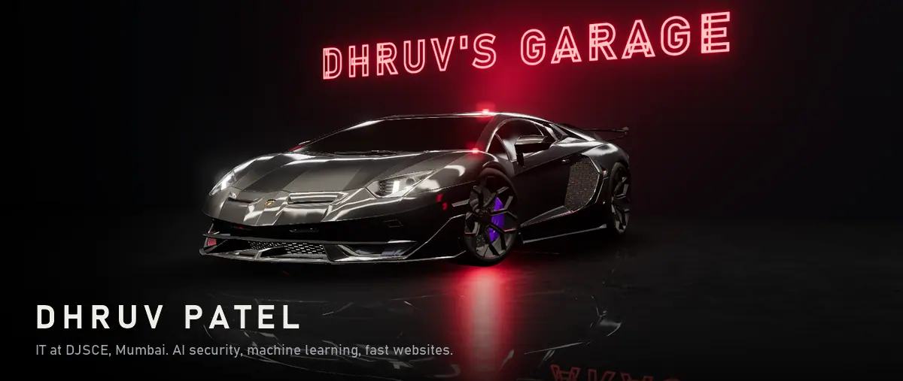
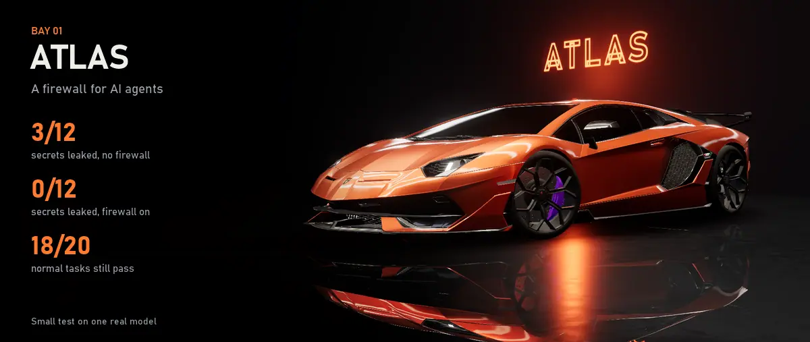
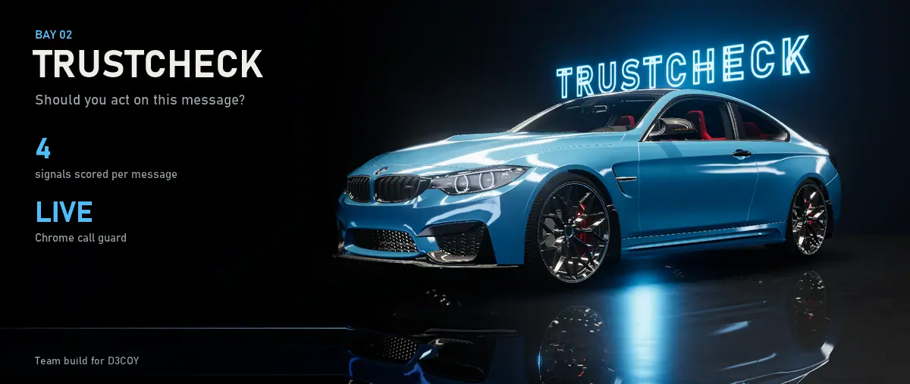
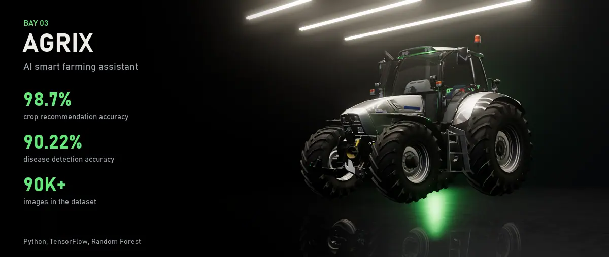
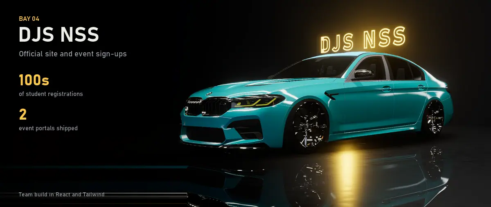
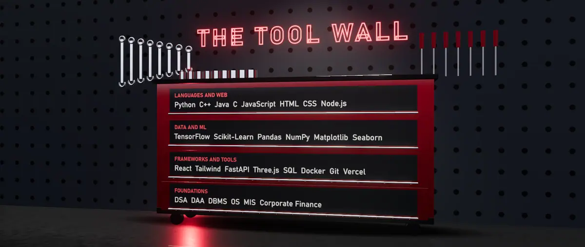
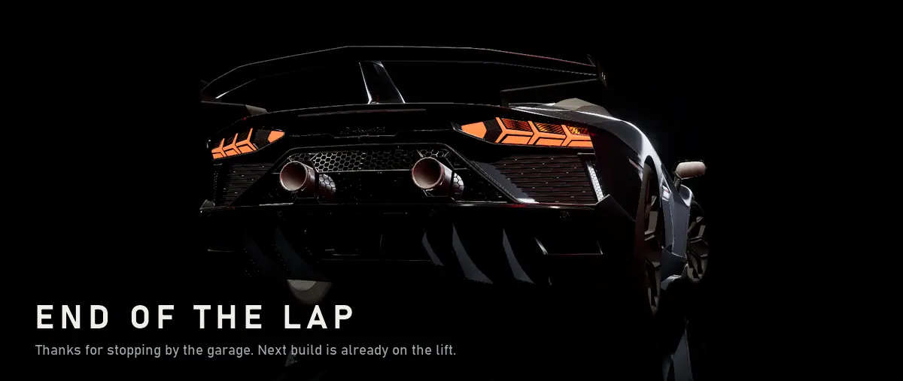

  

  <a href="https://atlas-psi-neon-19.vercel.app"><b>Try to beat ATLAS</b></a>
  &nbsp;&nbsp;|&nbsp;&nbsp;
  <a href="https://www.linkedin.com/in/dhruv-patel-077765292/"><b>LinkedIn</b></a>

Hi, I'm Dhruv. I study IT at DJSCE, Mumbai (2024 to 2028, CGPA 9.54) and I'm working towards AI and ML engineering. Most of what I build asks one question: can you trust what the machine just told you?

Outside class I'm Treasurer at DJS NSS. I'm an Oracle Certified Foundations Associate (95%), I've done AWS Cloud Practitioner Essentials, and I've solved 90+ problems on LeetCode.

Every project here gets its own car, because I like cars almost as much as I like shipping.

**01** [ATLAS](#atlas) &nbsp;&nbsp;|&nbsp;&nbsp; **02** [TrustCheck](#trustcheck) &nbsp;&nbsp;|&nbsp;&nbsp; **03** [AgriX](#agrix) &nbsp;&nbsp;|&nbsp;&nbsp; **04** [DJS NSS](#djs-nss) &nbsp;&nbsp;|&nbsp;&nbsp; [Skills](#skills)

---

## 01 · ATLAS

*A firewall that stops hidden instructions in documents from hijacking an AI agent.*

Ask an agent to summarize a PDF, and a line hidden inside it can tell the agent to email your data to someone else. ATLAS sits between the agent and its tools. It cleans what comes in, checks where every address came from, plants a canary secret, and replays risky calls without the document to see what really caused them.

`Python` `FastAPI` `React` `Three.js` `Docker`

[Live arena](https://atlas-psi-neon-19.vercel.app) &nbsp;|&nbsp; [Repo](https://github.com/Itzdhruvpatel/Atlas)

---

## 02 · TrustCheck

*Most deepfake tools ask "is this fake?" TrustCheck asks "should you act on this?"*

It scores the media, the wording, who the message claims to be from and what it asks you to do, then makes you verify before any money or data moves. A Chrome extension listens in on live Meet, Zoom and Teams calls. Built with my team for the D3COY hackathon.

`Python` `FastAPI` `React` `Chrome extension`

[Repo](https://github.com/D3C0Y-1-0/Semicolons_D3C0Y_DhruvPatel)

---

## 03 · AgriX

*Crop recommendations and plant disease detection for farmers.*

A Random Forest picks the crop. For disease detection I compared four CNNs: EfficientNetB0 was the most accurate, and MobileNetV2 came within a point of it at a size small enough for a phone. And yes, that's a Lamborghini. They made tractors before supercars.

`Python` `TensorFlow` `Scikit-Learn`

[Repo](https://github.com/raj06872436/AI_Farming_Project)

---

## 04 · DJS NSS

*The official National Service Scheme site at DJSCE, plus its event sign-up portals.*

Redesigned the official site with the team and built the sign-up portals for Grainathon and the Blood Donation Drive.

`React` `Tailwind CSS`

[Repo](https://github.com/djsnss/djsnss-web)

---

## Skills

**Languages:** `Python` `C++` `Java` `C` `JavaScript` `HTML` `CSS`

**ML and data:** `TensorFlow` `Scikit-Learn` `Pandas` `NumPy` `Matplotlib`

**Web and tools:** `React` `Tailwind CSS` `FastAPI` `Node.js` `Three.js` `SQL` `Docker` `Git`

---

  <a href="https://www.linkedin.com/in/dhruv-patel-077765292/"><b>Say hi on LinkedIn</b></a>

3D cars rendered in Three.js, all <a href="https://creativecommons.org/licenses/by/4.0/">CC BY 4.0</a>: <a href="https://sketchfab.com/3d-models/lamborghini-aventador-svj-sdc-free-784e4656aca649cca55d6b18740a19b2">Lamborghini Aventador SVJ</a> by SDC PERFORMANCE, <a href="https://sketchfab.com/3d-models/bmw-m4-f82-8e87379f40fd40dcac0a751e22c1a188">BMW M4 F82</a> by Black Snow, <a href="https://sketchfab.com/3d-models/lamborghini-tractor-r6-125-dcr-wwwvecarzcom-56d7c8e7e2cb4d15a3d80cc42c697c53">Lamborghini Tractor R6</a> by vecarz, <a href="https://sketchfab.com/3d-models/bmw-m5-cs-f90-8f74fb3420e24213aaeea33dc99450a3">BMW M5 CS</a> by fvrenbld. BMW and Lamborghini are trademarks of their owners; this profile isn't affiliated with them.
